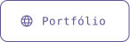
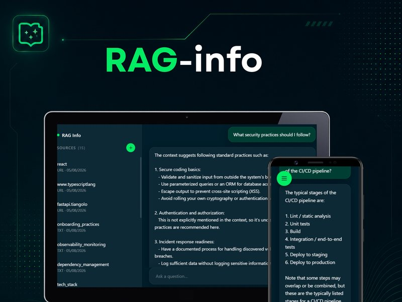
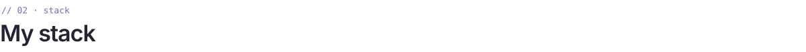
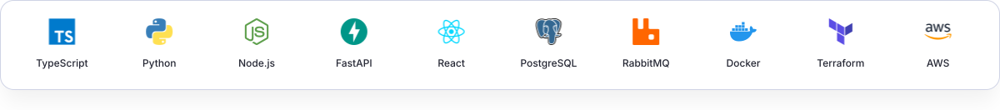
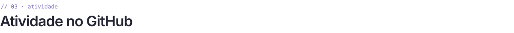

<a href="https://colacco.github.io/">
  <picture>
    <source media="(prefers-color-scheme: dark)" srcset="./assets/hero-dark.svg"/>
    
  </picture>
</a>

  <a href="https://colacco.github.io/"><picture><source media="(prefers-color-scheme: dark)" srcset="./assets/buttons/portfolio-dark.svg"/></picture></a>&nbsp;
  <a href="https://www.linkedin.com/in/gabriel-colacco"><picture><source media="(prefers-color-scheme: dark)" srcset="./assets/buttons/linkedin-dark.svg"/></picture></a>

<picture><source media="(prefers-color-scheme: dark)" srcset="./assets/divider-dark.svg"/></picture>

<picture><source media="(prefers-color-scheme: dark)" srcset="./assets/headings/projects-dark.svg"/></picture>

<table>
  <tr>
    <td width="50%" valign="top">
      
      <h3><a href="https://github.com/colacco/RAG-info">RAG-info</a></h3>
      
Converse com seus próprios documentos (PDFs, Markdown, páginas web) sem que nada saia da sua máquina. As respostas citam as fontes.

      <picture><source media="(prefers-color-scheme: dark)" srcset="./assets/chips/rag-info-dark.svg"/></picture>
      
<a href="https://github.com/colacco/RAG-info"><b>GitHub</b></a>

    </td>
    <td width="50%" valign="top">
      
      <h3><a href="https://github.com/colacco/PomodoroInu">Pomodoro Inu</a></h3>
      
Um timer Pomodoro para manter o foco nas sessões de estudo, em português e inglês.

      <picture><source media="(prefers-color-scheme: dark)" srcset="./assets/chips/pomodoro-inu-dark.svg"/></picture>
      
<a href="https://colacco.github.io/PomodoroInu/"><b>Demo ao vivo</b></a> &nbsp;·&nbsp; <a href="https://github.com/colacco/PomodoroInu">GitHub</a>

    </td>
  </tr>
</table>

<picture><source media="(prefers-color-scheme: dark)" srcset="./assets/divider-dark.svg"/></picture>

<picture><source media="(prefers-color-scheme: dark)" srcset="./assets/headings/stack-dark.svg"/></picture>

<picture>
  <source media="(prefers-color-scheme: dark)" srcset="./assets/stack-dark.svg"/>
  
</picture>

<picture><source media="(prefers-color-scheme: dark)" srcset="./assets/divider-dark.svg"/></picture>

<picture><source media="(prefers-color-scheme: dark)" srcset="./assets/headings/activity-dark.svg"/></picture>

  <picture>
    <source media="(prefers-color-scheme: dark)" srcset="https://streak-stats.demolab.com?user=colacco&background=232532&border=3F424D&stroke=3F424D&ring=B5ABFC&fire=9184D9&currStreakNum=E9E9ED&sideNums=E9E9ED&currStreakLabel=B5ABFC&sideLabels=9397AB&dates=9397AB&border_radius=16"/>
    
  </picture>

<picture><source media="(prefers-color-scheme: dark)" srcset="./assets/divider-dark.svg"/></picture>

  <a href="https://colacco.github.io/"><picture><source media="(prefers-color-scheme: dark)" srcset="./assets/footer-dark.svg"/></picture></a>

